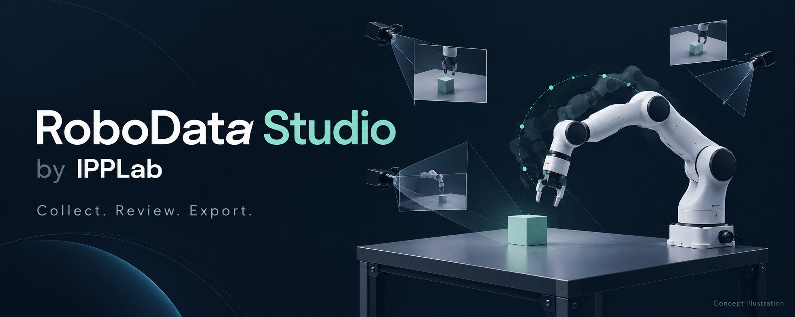
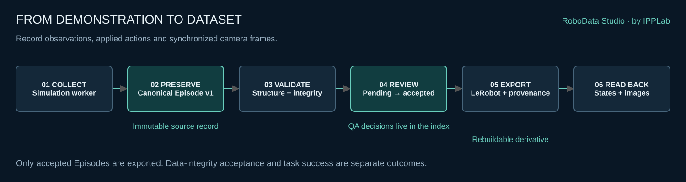
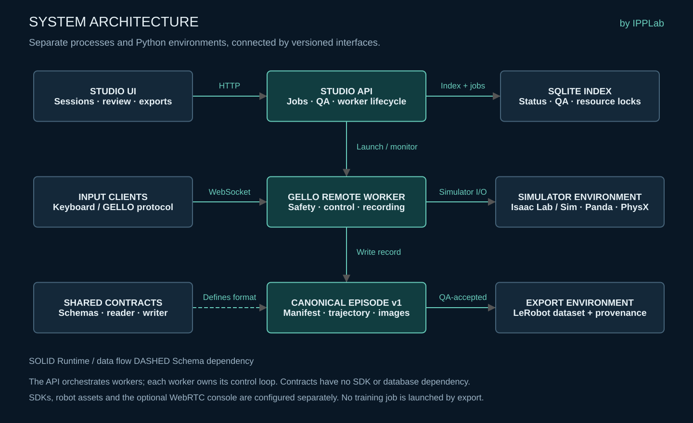

# RoboData Studio

**A simulation-first workspace for robot demonstration data.**
Collect multi-view Episodes, review data quality, and export traceable datasets for robot learning.

[English](README.md) · [简体中文](README.zh-CN.md) · [Installation](docs/INSTALLATION.md) · [Architecture](docs/ARCHITECTURE.md) · [Validation](docs/VALIDATION.md)

**by IPPLab** · Apache-2.0 original code · Initial public release

## From collection to usable datasets

Robot demonstrations combine control signals, observations, camera streams and
review decisions. RoboData Studio brings these pieces into one workflow while
keeping raw recordings, QA metadata and training-format exports distinct.

- **Manage collection sessions.** Configure the reference Isaac Panda task and track worker lifecycle from the Studio UI.
- **Record through GELLO Remote.** Use the bundled input protocol, safety filters and simulation workers; keep control inside the worker process.
- **Keep a canonical source.** Store manifest, trajectory and camera frames in versioned `robot_data_episode` v1 records, shared across tools through a standalone contracts package.
- **Review before export.** Track QA decisions in the index and select accepted Episodes explicitly for export.
- **Trace exported data.** Produce rebuildable learning datasets with source provenance and validate them through consumer readback.

The reference configuration is **Isaac Panda · `rigid_cube_lift` · PhysX · Keyboard/GELLO protocol**.
See [release validation](#release-validation) for the tested scope.

## Data workflow



Original Episodes remain unchanged. Scanning indexes them as pending; QA acceptance
controls export eligibility. Operator outcome, evaluator outcome and data-quality
acceptance are recorded separately, so unsuccessful task trajectories can retain
useful, valid data without being labeled successful.

Exports carry source provenance and explicit action/gripper semantics. LeRobot
readback checks the resulting data, while policy training is a separate workflow.

## System architecture



| Component | Role | Source |
| --- | --- | --- |
| Studio UI | Sessions, Episode review and export controls | [`app/`](app/), [`components/`](components/) |
| Studio API | Index, QA decisions, jobs and worker orchestration | [`backend/`](backend/) |
| GELLO Remote | Input ownership, safety checks, simulation control and recording | [`teleop/`](teleop/) |
| Robot Data Contracts | Versioned schemas, writer, reader and validation | [`packages/robot-data-contracts/`](packages/robot-data-contracts/) |
| Export environment | Training-format conversion through an explicit interpreter | [Configuration guide](docs/INSTALLATION.md#lerobot-export) |

The API, simulator and LeRobot environments are isolated. The worker owns the
control loop; the shared contracts have no simulator SDK or database dependency.
See [architecture and interface boundaries](docs/ARCHITECTURE.md) for details.

## Quick start: UI and API

Requires Python 3.12+ and Node.js 22.13+. Use the complete checkout so backend wheel
builds can include the adjacent configuration files. From the repository root:

```bash
python3.12 -m venv backend/.venv
backend/.venv/bin/python -m pip install ./packages/robot-data-contracts ./teleop './backend[dev]'
# Review the template first; keep any existing local configuration.
test -f .env || cp .env.example .env
set -a
source .env
set +a
backend/.venv/bin/python -m uvicorn robot_data_studio.main:app --host 127.0.0.1 --port 8010
```

In another terminal, from the same repository:

```bash
npm ci --no-audit --no-fund
npm run build
npm run start -- --hostname 127.0.0.1 --port 3000
```

Open `http://127.0.0.1:3000`; API documentation is at `http://127.0.0.1:8010/docs`.
For development use `npm run dev -- --host 127.0.0.1`. Set `NEXT_PUBLIC_STUDIO_API`
before the frontend build if the API address differs. Local builds do not require
Sites/Cloudflare accounts or hosting metadata.

The UI/API can run without a simulator. Recording requires a separately installed,
compatible SDK, robot asset, explicitly selected GPU and worker environment. See
[installation](docs/INSTALLATION.md) before launching collection.


## Release validation

| Scope | Evidence |
| --- | --- |
| Public source snapshot | 173 selected CPU regression tests passed; frontend production build and root TypeScript checks passed |
| Packaging | Contracts, teleop and backend wheels built; license files and absence of the prebuilt vendor console checked |
| Earlier simulated end-to-end run | 100 frames, four cameras, QA-gated LeRobot export and CPU readback; performed on an internal predecessor |

The earlier collection used agent-generated Keyboard messages and retained a
**failed cube-lift trajectory**. It demonstrates the data path, not task success.
This public snapshot has not repeated GPU collection or established physical
GELLO, real-robot operation, fresh-machine reproduction or downstream training.
The selected CPU tests are not the full suite. See [the complete record](docs/VALIDATION.md).

### Runtime and asset requirements

The optional WebRTC console is supplied as [integration source](teleop/web_console/).
Its NVIDIA-dependent prebuilt bundle is excluded; review the applicable terms and
[build locally](docs/INSTALLATION.md#optional-collector-console). Until built, the
Collector root page reports `Web console is not built`; worker WebSocket access
and recording code remain available independently.

Simulator SDKs, robot USD assets, datasets and model checkpoints are configured
separately. Nominal camera profiles are examples, not measured hardware calibration.
Optional cloth, generation and asset extensions are disabled by default and require
separate dependencies and validation.

## Tools by IPPLab

RoboData Studio connects collection and dataset preparation within the IPPLab tool
series. **SceneKit** (scene descriptions) and **DataAugment** (data augmentation)
are proposed roadmap names. GELLO Remote and Robot Data Contracts are bundled here.
See the [ecosystem roadmap](docs/ECOSYSTEM.md) for responsibilities and release status.

## License and credits

Original code the contributors are authorized to license is available under
[Apache-2.0](LICENSE). See [NOTICE](NOTICE), [third-party notices](THIRD_PARTY_NOTICES.md)
and [asset licensing boundaries](docs/LICENSES_AND_ASSETS.md) for exceptions.
External SDKs and assets retain their own terms.

The cover is an AI-generated concept illustration, not a product screenshot or
hardware result. Technical diagrams describe the implemented interfaces.
[Visual sources and editable diagram specifications](docs/assets/README.md) are included.
